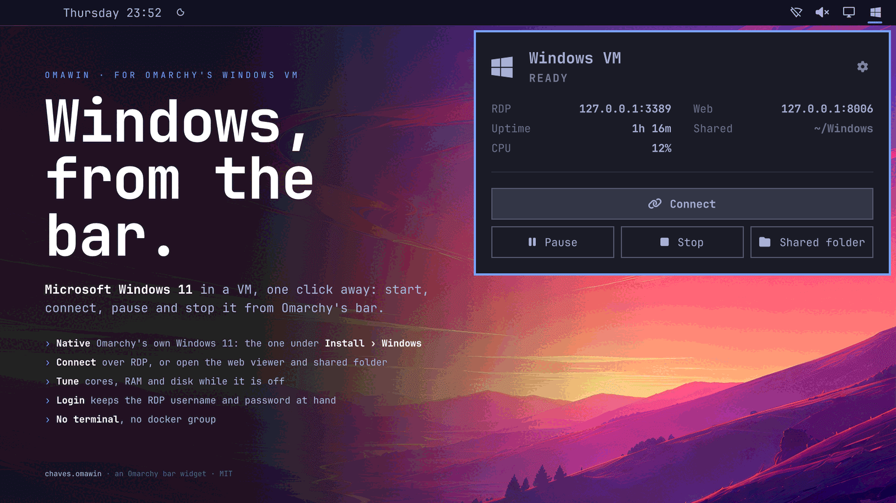
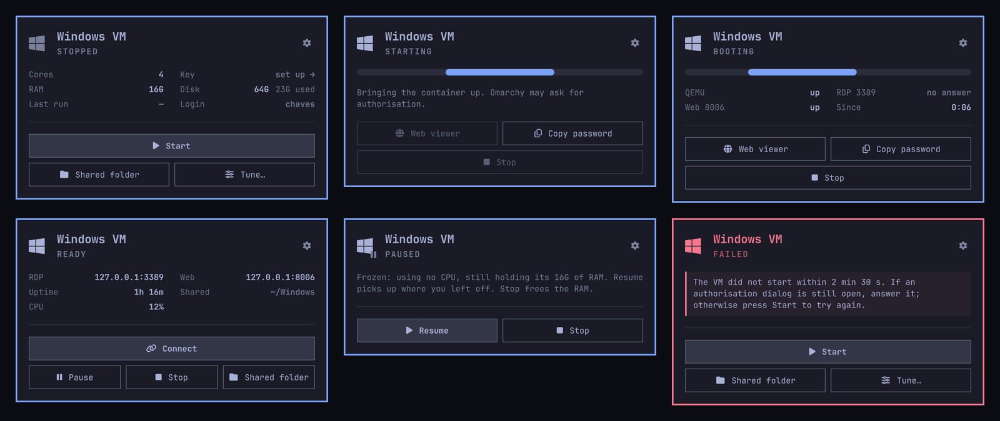
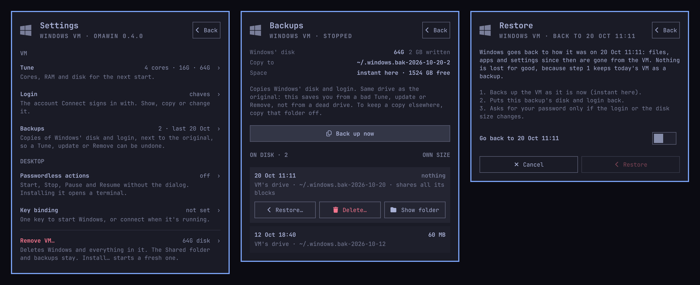

<p align="center"></p>

# Omawin

[](https://github.com/tcballard/omarchy-badges)

**Windows, from the bar.** Omarchy ships a Windows 11 VM (*Install › Windows*
in the Omarchy menu). Omawin puts it in the bar: one glyph that says whether
Windows is up, and a card to **start, connect, pause, resume and stop** it,
open the web viewer and the shared folder, **tune** its cores, RAM and disk,
and keep its **login** a click away.

It needs no `docker` group and no configuration: it reads the VM's state
unprivileged and acts through Omarchy's own `omarchy-windows-vm` helper, the
same one the launcher entry runs.

## What you need

- **Omarchy 4** with its Quickshell shell (built and tested against 4.0.3).
- **Omarchy's Windows VM.** Not installed yet? The card has an **Install**
  button that runs Omarchy's own installer.

## Install

```sh
omarchy plugin add https://github.com/diogochaves/omawin --enable
```

Or from its page in the
[Omarchy plugin directory](https://plugins.omarchy.org/plugin.html?id=chaves.omawin).
The Windows glyph appears in the bar. To place it:

```sh
omarchy bar move chaves.omawin --section right --after omarchy.tray
```

On Omarchy 4.5 it can also live in the tray's drawer, out of the bar until
you open the drawer; the card opens from there the same way:

```sh
omarchy bar move chaves.omawin --section tray
```

Start, Stop, Pause and Resume ask for your password each time until you turn
on **Passwordless actions** in the card's Settings. Tune and Login's Change…
always ask.

**Update** with `omarchy plugin update chaves.omawin`.

## Remove

```sh
omarchy plugin remove chaves.omawin
```

The VM itself is Omarchy's and stays. To remove it too, use **Settings ›
Remove VM…** on the card before removing the plugin, or run
`omarchy-windows-vm remove`. After a confirmation it deletes the VM, its disk
`~/.windows` and its login `~/.config/windows` for good, so back up first if
you may want them again (see
[Restoring a backed-up VM](#restoring-a-backed-up-vm)). The shared folder
`~/Windows` stays. Install… on the card, or `omarchy-windows-vm install`,
starts a fresh one.

Two things of Omawin's can stay behind:

- `~/.local/state/omawin/`, the card's memory of the last run:
  `rm -r ~/.local/state/omawin`.
- The polkit rule, only if you turned on Passwordless actions. Turn it off in
  Settings **before** removing the plugin, or afterwards run
  `sudo rm /etc/polkit-1/rules.d/49-omawin.rules`.
- The clean-shutdown unit, only if you turned on Clean shutdown. Turn it off
  in Settings **before** removing the plugin, or afterwards run
  `sudo systemctl disable omawin-vm-shutdown.service` and
  `sudo rm /etc/systemd/system/omawin-vm-shutdown.service`. It is harmless
  without the plugin: it never runs the plugin's own files.

## Using it

**Left click** the glyph for the card; **middle click** starts the VM,
connects when it is up, or brings the Windows window forward when it is
already open. Hover for its state, shape and uptime.

**A key for it:** add a line like this to `~/.config/hypr/bindings.lua`. The
key does what a middle click does. **Settings › Key binding** has the line
with Copy and Open buttons, and once it's there the stopped card and the
tooltip show your key:

```lua
o.bind("SUPER + ALT + W", "Windows VM", "omarchy-shell chaves.omawin primary")
```

<p></p>

- **Stopped**: Start, Shared folder, and Tune the shape the next start will
  use. Disk says how much of it Windows has really written.
- **Starting / Booting**: the VM is coming up. The web viewer already works
  while Windows boots, which is where you watch a first install; if Windows
  asks for its password there, **Copy password** has it.
  If Windows still hasn't answered on RDP after 2½ minutes, the glyph stops
  breathing and turns yellow, and the card says what may be blocking it.
- **Ready**: Connect opens the Windows window, signed in. Pause, Stop,
  Shared folder. CPU shows how busy Windows is right now.
- **Paused**: frozen in memory, using no CPU but still holding all of its
  RAM. Resume picks up where it left off and reopens the window; only Stop
  gives the RAM back.
- **Failed**: what went wrong, and what to try. The buttons underneath still
  work, so you can retry.

**Shared folder** is `~/Windows`, a network drive inside Windows. The rest
(Login, the web viewer of a ready VM, Back up) is in Settings.

<p></p>

- **Tune** (VM off) sets cores, RAM and disk for the next start. The disk can
  only grow; after it does, extend C: in Windows' Disk Management and the card
  reminds you how. A smaller disk needs a new VM: back up, Remove VM…, then
  Install… with the size you want.
- **Login** shows the RDP username, and reveals or copies the password. A
  copied password stays out of Omarchy's clipboard history and is cleared
  after 30 s. Changed the password inside Windows, or want to log in as
  another account? **Change…** opens the fields in place, so Connect keeps working.
- **Settings** (the gear) is a list: Tune, Login, Backups, Clean shutdown,
  Passwordless actions, Key binding and Remove VM…, each with its current
  value and a line on what it does. **Passwordless actions** is a polkit rule
  that lets Start, Stop, Pause and Resume run without a dialog, for you only.
  It opens a terminal, shows you the rule and asks before writing it.
- **Clean shutdown** (in Settings) makes a reboot or power-off wait for
  Windows to shut down. Omarchy gives every service 5 seconds to stop, Docker
  included, so without it Windows is cut off as if the power went, paused or
  not. It installs a small system unit that, just before Docker stops, wakes
  a paused VM and stops it, giving Windows up to 2 minutes. Like the rule, it
  opens a terminal and shows the file before writing it.
- **Backups** (in Settings) lists every backup on disk, newest first, with
  its drive and what deleting it would free (on btrfs a fresh one frees
  nothing: it shares Windows' blocks). **Back up now** (VM off) copies
  Windows' disk and login into a folder next to the original,
  `~/.windows.bak-<date>` (or beside the folder `~/.windows` points to, if
  you moved it to another drive): instant on btrfs, a full copy elsewhere,
  with progress and Cancel. **Delete…** on a backup asks first, then
  frees what it said, and **Restore…** puts one back: see
  [Restoring a backed-up VM](#restoring-a-backed-up-vm).
- **Remove VM…** (in Settings, VM off) deletes Windows and everything in it,
  for a fresh start or a smaller disk. It lists what goes and what stays, and
  asks you to say you've backed up: Backups…, or copy what you want to keep
  into the Shared folder, which stays. Then Omarchy's own remover runs in a
  terminal and asks you to confirm.

**‹ Back** at the top right, or **Esc**, goes back.

On omarchy-console's rail, the glyph slides up while the VM is running
(ready or paused), with an amber edge while it starts, boots or stops and a
red one when it failed. It reports this through the console's `consoleAwake`
and `consoleState` properties.

## Restoring a backed-up VM

A backup is two things: the `~/.windows` folder (the disk) and
`~/.config/windows/credentials` (the login Connect uses). **Settings ›
Backups › Back up now** copies both, with the VM off, into
`~/.windows.bak-<date>`, or, when `~/.windows` is a link to a folder on
another drive, next to that folder (`/mnt/data/windows` →
`/mnt/data/windows.bak-<date>`); the face shows where. Its `windows` folder
is the disk, its `credentials` file the login. It is on the same drive as the
VM, so copy that folder somewhere else to survive a reinstall or a dead
drive.

**From the card**, with the VM off: Settings › Backups, open a backup,
**Restore…**, turn on "Go back to …" and press **Restore**. It first backs up
the VM as it is, so the restore can be undone from the same list; then it
puts the backup's disk and login back, instant on btrfs. It asks for your
password only when the backup's login or disk size differs from the VM's,
since that rewrites Omarchy's settings for the VM. Then press Start.

**After Remove VM**, or after reinstalling Omarchy, the card shows
**Restore…** beside Install… when it finds a backup: beside where the VM
was, in your home folder, or at the top of a mounted drive (`/mnt/*`,
`/media/…`). Restore puts the backup back where it was made, and when that
was another drive, links `~/.windows` to it again. It asks for your password
once, to set the VM up with the backup's login and disk and the cores and
RAM it had (or 2 cores and 4G for a backup older than 0.4.0; Tune changes
them). The first Start downloads Omarchy's Windows image again, which Remove
deletes.

**By hand**, for a backup the card doesn't find:

1. Put the backup's `windows` folder back as `~/.windows` (move the current
   one aside first if there is one). Copy it into a fresh folder with
   copy-on-write off, as Windows' installer makes it, which on btrfs is
   instant and keeps the backup:

   ```bash
   mkdir ~/.windows && chattr +C ~/.windows
   cp -a --reflink=auto ~/.windows.bak-<date>/windows/. ~/.windows/
   ```

   For a backup beside a folder on another drive, put it back there, and
   point `~/.windows` at it again (`ln -s /mnt/data/windows ~/.windows`).

   Moving the folder back (`mv`) works too, if you don't need to keep the
   backup.
2. Press **Install…** on the card. For the username and password, enter the
   two lines of the backed-up credentials file. Pick a disk at least as big as
   the old one; cores and RAM are up to you, and Tune changes them later.
3. The installer finds the disk already there, skips the download and boots
   your old Windows. Press **Connect**.

Windows keeps the accounts it already has: the login you type only tells
Connect what to send. If the card says Windows rejected the username or
password, copy the backed-up credentials file over
`~/.config/windows/credentials`, which is what Connect reads, and connect
again. The password is the account's password, not its PIN.

## What it touches

- **Reads**, as you: `/proc` and cgroup files for the VM's state and usage,
  the size of `~/.windows/data.img`, the username in
  `~/.config/windows/credentials`, and the RDP and web viewer ports on
  `127.0.0.1`. Nothing leaves the machine.
- **Runs**: Omarchy's `omarchy-windows-vm` for start, stop, install and
  remove (the last two in a terminal), and
  `pkexec docker pause|unpause omarchy-windows`. Tune and Login's Change…
  rewrite the VM's compose through the helper's own validated writer, which
  regenerates the whole file: keys you added to it by hand are dropped.
  Passwords go on stdin, never on a command line.
- **Writes**: `~/.local/state/omawin/`, the credentials file when you update
  the password, and the VM's compose through Omarchy's helper. The backups
  you make, and on a restore the VM's folder, the credentials file and, with
  no VM, the `~/.windows` link, the Shared folder and the launcher's Windows
  entry, as Omarchy's installer makes them. No other configuration is
  touched.

The full list, the Pause and Stop details, the tuning table and what the
polkit rule allows are in [Under the hood](docs/under-the-hood.md). Working on
the widget: [Developing](docs/developing.md). What changed:
[CHANGELOG](CHANGELOG.md).

## License

MIT.
